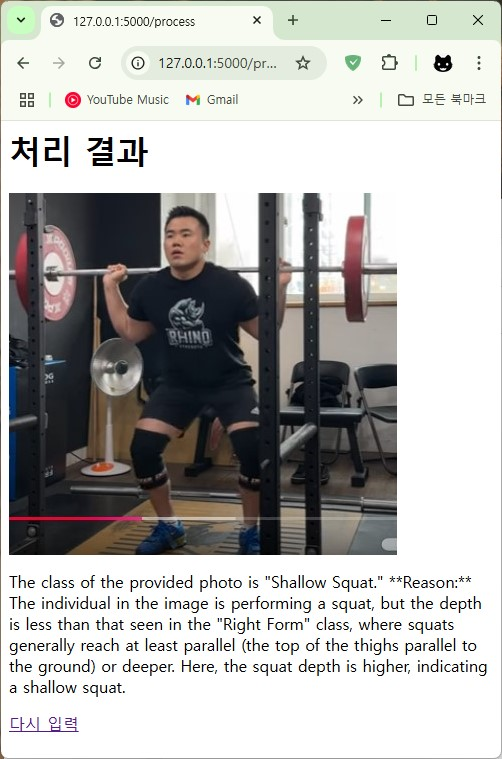
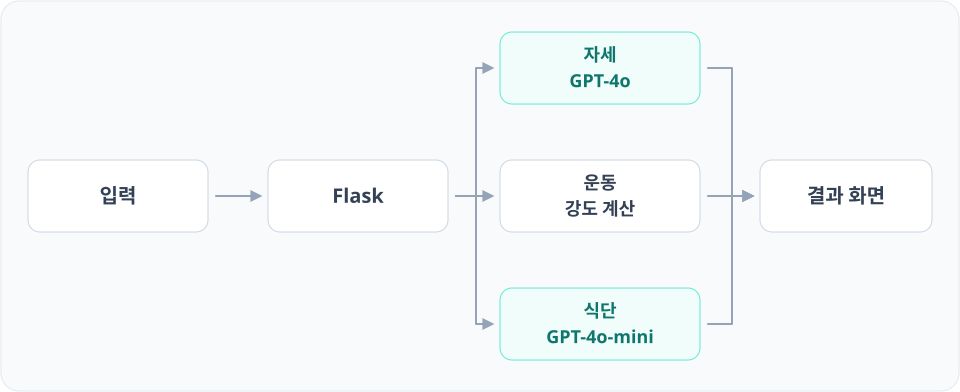

# AI Trainer

<!-- 프로젝트 개요·구현 흐름·실행 안내 -->

**운동 사진의 URL을 입력받아 자세 분석 결과와 운동·식단 가이드를 제공하는 Flask 서비스**


**개인 개발** · 조동휘: 서비스 설계·구현 · 연구 자료의 저자 정보는 하단에 표기

[서비스 화면](#서비스-화면) · [구현 구조](#구현-구조) · [프로젝트 구조](#project-structure) · [모델 비교](#모델-비교와-연구-기록) · [실행 방법](docs/SETUP.md)

## 서비스 화면

<a href="docs/assets/screenshots/결과화면.jpg"></a>

*개발 당시 자세 분석 결과 · 이미지 클릭 시 원본 확인*

## 프로젝트 개요

- **자세 분석**: 운동 이미지 URL·예시 이미지를 GPT-4o에 전달하고 스쿼트 자세 분류·설명 표시
- **운동 강도**: 성별·체중·키·골격근량으로 운동 수준·스쿼트 중량 계산
- **식단 제안**: 골격근량·보유 식재료를 GPT-4o-mini에 전달해 식단 생성

## 구현 구조

<picture>
  <source media="(max-width: 1000px)" srcset="docs/assets/service-flow-mobile.svg">
  
</picture>

### 01. 웹 입력부터 AI 응답까지 연결

- Flask 폼 → 별도 Python 스크립트 실행 → 표준 출력 → 결과 템플릿 연결
- 자세 분석 입력: **접근 가능한 이미지 URL** 사용, 파일 업로드 미지원

[Flask 라우트](web/app.py) · [자세 분석](web/posture_analysis.py) · [식단 제안](web/diet_advice.py)

### 02. 예시 이미지로 판단 기준 제공

- 클래스별 5장, 총 20장의 예시 이미지를 요청에 포함
- 가중치 재학습 없이 **Few-shot prompting**으로 판단 기준 제공

| 분류 | 의미 |
| :--- | :--- |
| Shallow Squat | 가동 범위 부족 |
| Knee Valgus | 무릎이 안쪽으로 모이는 자세 |
| Wrong Spinal Alignment | 척추 정렬 문제 |
| Right Form | 올바른 자세 |

### 03. 연구 코드와 서비스 코드 구분

- `experiments`: 모델·프롬프트 비교 실험
- `web`: 사용자 입력·API 호출·결과 표시
- MediaPipe·GPT의 실시간 앙상블은 미구현

<a id="project-structure"></a>

## 📂 프로젝트 구조

```text
AITrainer/
├── web/  # Flask 웹 서비스
│   ├── app.py  # 웹 라우트·운동 강도 계산
│   ├── posture_analysis.py  # 자세 분석 API 호출
│   ├── diet_advice.py  # 식단 제안 API 호출
│   ├── requirements.txt  # 웹 서비스 의존성
│   └── templates/  # 입력·결과 화면
├── experiments/
│   ├── gpt/  # 번호별 모델·프롬프트 비교 실험
│   └── mediapipe/  # Pose 실험·기존 실험용 이미지
├── data/
│   ├── squat/  # 자세별 예시 이미지
│   └── legacy_squat/  # 이전 예시 이미지
├── docs/
│   ├── reports/  # 연구 보고서·발표 자료
│   ├── evaluation/  # 평가 원본·결과 이미지
│   └── assets/  # 서비스 화면·기타 기록 이미지
└── requirements.txt  # 웹 의존성 설치
```

## 모델 비교와 연구 기록

- 평균 F1: **Improved ChatGPT 0.83**, MediaPipe 0.73 (기존 보고값)
- 이미지 40장 기준 비교, 클래스별 결과 차이 있음

<details>
<summary>모델별 수치·실험 조건 보기</summary>

- 출처: [연구 보고서](docs/reports/AI%20Trainer%20for%20Fitness%20Beginner_조동휘.pdf) **4~6쪽 보고값**
- 기존 보고값 인용, 실험 재실행·원시 결과 재집계 미수행

### 모델별 비교 (논문 그림 14·16·19·22)

클래스별 평균 · 원문 소수 둘째 자리 표기 유지

| 모델 | Precision | Recall | 평균 F1 | Accuracy (클래스별 평균) |
| :--- | ---: | ---: | ---: | ---: |
| MediaPipe Pose | 0.75 | 0.75 | 0.73 | 0.88 |
| Plain ChatGPT | 0.63 | 0.53 | 0.50 | 0.76 |
| Trained ChatGPT (예시 이미지 제공) | 0.71 | 0.70 | 0.69 | 0.85 |
| **Improved ChatGPT** | **0.86** | **0.83** | **0.83** | **0.91** |

- 클래스별 차이: 척추 정렬 F1 **0.60 → 0.82**, 가동 범위 부족 **1.00 → 0.70** (MediaPipe → Improved ChatGPT)
- Accuracy: 클래스별 이진 분류 정확도의 평균. 전체 40장의 다중 클래스 정답률과는 다른 지표

### Ablation study (논문 그림 24)

최종 설정에서 언어·지시·예시 조건을 하나씩 변경한 보고값

| 조건 | Precision | Recall | 평균 F1 | Accuracy (클래스별 평균) |
| :--- | ---: | ---: | ---: | ---: |
| 최종 설정 (Improved ChatGPT) | 0.8621 | 0.825 | 0.8292 | 0.9125 |
| 영어 → 한국어 (Translation) | 0.7996 | 0.775 | 0.7749 | 0.8875 |
| 역할 지시 제거 (Role Omission) | 0.815 | 0.775 | 0.783 | 0.8875 |
| 이전 예시 데이터 (Old Training Data) | 0.7439 | 0.7 | 0.6964 | 0.85 |

- 논문의 "Trained"·"Training Data": 요청에 예시 이미지를 포함하는 few-shot prompting
- 공개 평가 코드의 시스템 지시: `make sure to provide the answer the user wants.` (특정 의료 전문가 페르소나 지시 없음)

### 평가 범위

- 저장소의 예시 이미지: 클래스별 5장, 총 20장
- 평가 이미지: 별도 경로에 4개 클래스별 10장, 총 40장
- 평가 스크립트: 클래스별 평가 이미지 10장을 한 요청에 전달
- 반복 실행 횟수·실행 간 변동성: 논문에서 확인 불가
- 해당 이미지 평가셋의 보고값으로, 다른 운동·사용자·촬영 조건에 대한 일반화 미검증

[평가 스크립트](experiments/gpt/experiment_05_improved_chatgpt.py) · [평가 원본 파일](docs/evaluation/Model_evaluation_result.xlsx) · [결과 이미지](docs/evaluation/Output_results_for_each_model)

</details>

## 실행과 검증

- [설치·실행 안내](docs/SETUP.md): 가상환경·API 키·서버 실행·입력 형식
- [검증 기록](docs/VALIDATION.md): 로컬 화면 확인·실제 AI 호출 검증 범위

## 현재 한계와 다음 개선

- 동기 API 호출: 타임아웃·실패 안내 보강 필요
- 이미지 URL·입력 검증, 결과 구조화 개선 예정
- 매 호출에 예시 이미지 포함: 지연 시간·비용 측정 필요
- 운동·식단 응답은 연구용 가이드이며, 개인 신체 상태에 대한 진단 검증 없음

## 연구 자료

**Kyung Hee University, School of Computing**<br>
연구 자료 저자: 조동휘(DongHwee Cho), 성무진(Mujeen Sung)

[연구 보고서](docs/reports/AI%20Trainer%20for%20Fitness%20Beginner_조동휘.pdf) · [발표 자료](docs/reports/AI%20Trainer%20for%20Fitness%20Beginner_조동휘.pptx)


